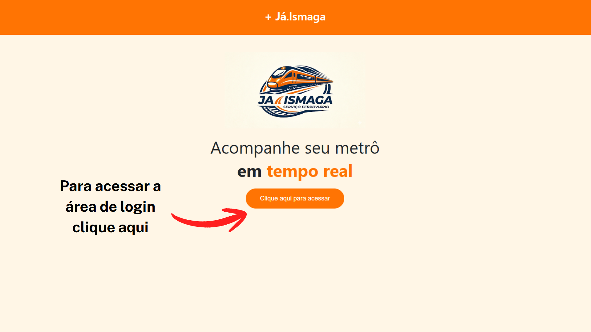
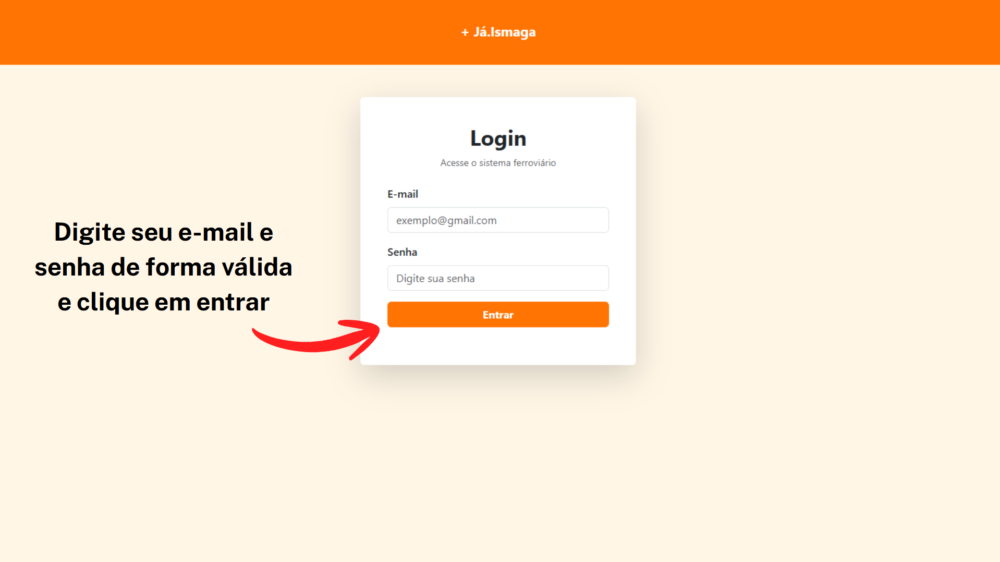
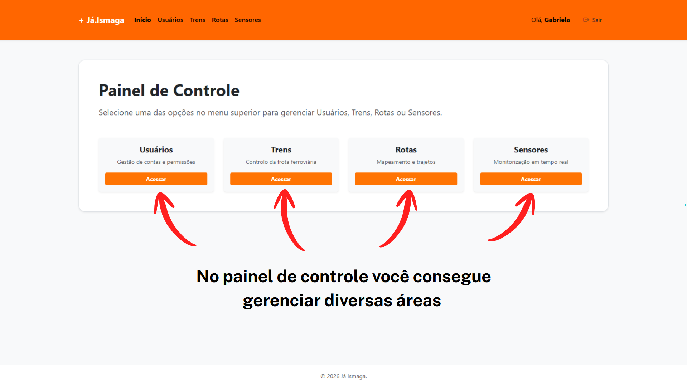
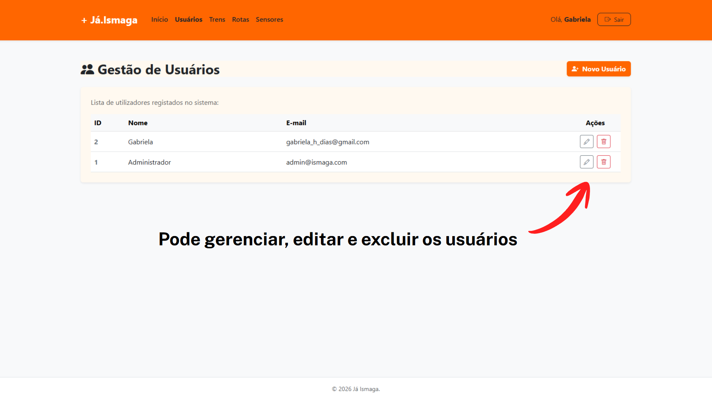
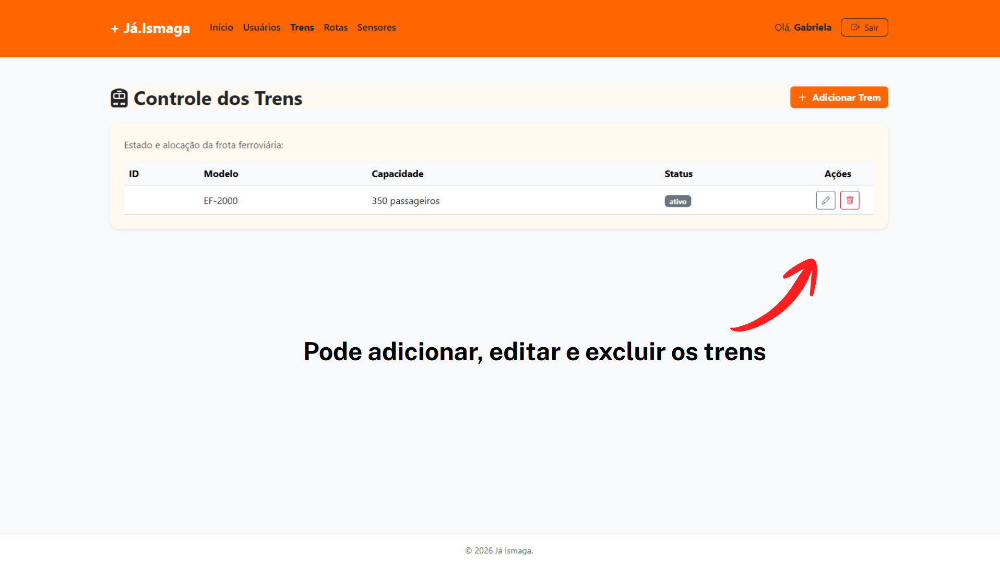
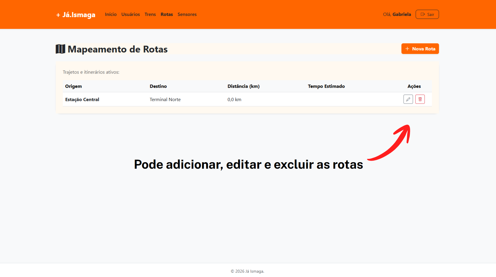
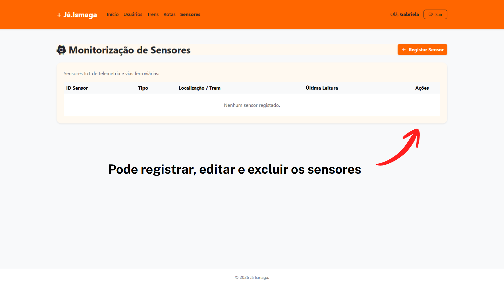
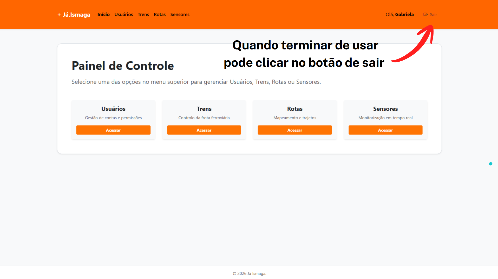

# Já Ismaga — Ferrorama IoT e Indústria 4.0

- Nome do produto: Já.Ismaga 
- Versão: 6.51
- Fabricantes: Gabriela Dias, Isabela Albano, Jaime Rodrigues, Maria Eduarda Loretto. 

## Introdução
O Ferrorama IoT, desenvolvido pela Já.Ismaga, representa os pilares de inovação da Indústria 4.0. 

Através da integração de sensores avançados, atuadores e conectividade sem fio, o sistema fornece visualização analítica contínua e processamento de informações em tempo real. O projeto serve tanto como plataforma demonstrativa para automação e logística industrial quanto como um ambiente didático e executivo para validação de conceitos de conectividade e monitoria preditiva.

---

## Visão Geral do Produto
O Ferrorama IoT reinterpreta a dinâmica dos trilhos tradicionais sob a ótica da conectividade total. O sistema funciona em quatro etapas integradas, acompanhando a jornada da informação desde a via física até a tomada de decisão:

Na própria locomotiva e ao longo dos trilhos, sensores inteligentes monitoram constantemente variáveis como velocidade, posição e vibração, enquanto atuadores executam desvios e sinalizações automáticas.

Os dados coletados são reunidos pelo microcontrolador, que atua como a central de inteligência embarcada responsável por unificar as leituras do ambiente.

Utilizando redes sem wi-fi e protocolos otimizados como MQTT e REST, as informações viajam instantaneamente até o servidor com latência mínima.

## Público-Alvo
- Pessoas que precisam se locomover à algum local desejado.

## Instruções de uso
Passo a passo com imagens

  

  

  

  

  

  

  

  

## Funcionalidades principais
- Cadastrar rotas, sensores, usuários

## Dicas e boas práticas
- Cuidados no manuseio. 
- Login de Utilizadores: Interface segura para autenticação de operadores. Validação de Credenciais: Integração e verificação de acessos via banco de dados MySQL.

## Recomendações para uso seguro
Sessão Segura: Função de logout e controle de permissões para encerramento de atividades na mesa de controle.

## Solução de problemas 
Perguntas frequentes e erros comuns 
Falhas no JavaScript, Problemas com o commit, problemas no XAMPP e no MySQL, problema no index e na conexão.

## Suporte e contatos
- E-mail: admin@ismaga.com
- Telefone: (47) 9 6306-2560
