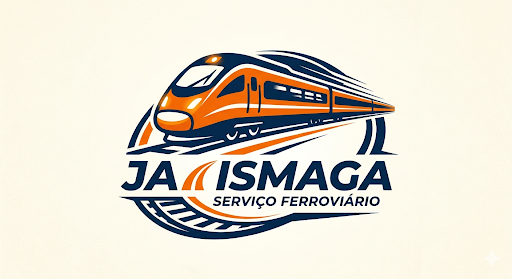

# Já Ismaga — Ferrorama IoT e Indústria 4.0

<p align="center">
  
  
</p>

<p align="center">
  
</p>

---

## Índice
- [Descrição do Projeto](#descrição-do-projeto)
- [Novidades e Atualizações do Sistema](#novidades-e-atualizações-do-sistema)
- [Funcionalidades e Requisitos Funcionais (RFs)](#funcionalidades-e-requisitos-funcionais-rfs)
- [Integração com APIs Externas](#integração-com-apis-externas)
- [Identidade Visual e Teoria das Cores](#identidade-visual-e-teoria-das-cores)
- [Mapeamento de Interfaces (CRUD UI)](#mapeamento-de-interfaces-crud-ui)
- [Firmware e Hardware (IoT)](#firmware-e-hardware-iot)
- [Utilização de Inteligência Artificial](#utilização-de-inteligência-artificial)
- [Pesquisas Técnicas e Documentação](#pesquisas-técnicas-e-documentação)
- [Metodologia de Desenvolvimento e Kanban](#metodologia-de-desenvolvimento-e-kanban)
- [Padrões de Código (Style Guide)](#padrões-de-código-style-guide)
- [Tecnologias e Ferramentas](#tecnologias-e-ferramentas)
- [Instruções de Execução do Sistema](#instruções-de-execução-do-sistema)
- [Estrutura do Projeto](#estrutura-do-projeto)

---

## Descrição do Projeto

O projeto **Já Ismaga — Ferrorama IoT** conecta maquetes e linhas férreas tradicionais aos conceitos da **Indústria 4.0**, integrando automação, monitoramento e telemetria ferroviária em tempo real.

A solução consiste em uma plataforma web integrada a sensores e microcontroladores embarcados na malha ferroviária. O sistema realiza a coleta e transmissão contínua de dados operacionais, permitindo o acompanhamento preditivo de falhas, o controle logístico de rotas e o gerenciamento da frota de trens e equipes.

<p align="center">
  
</p>

---

## Novidades e Atualizações do Sistema

- **Arquitetura de Banco com MySQLi:** Migração e padronização completa das consultas para a extensão nativa `mysqli` (`$conn`), utilizando *prepared statements* (`bind_param`) e tratamento de exceções de integridade referencial (`ON DELETE SET NULL` e tratamento do erro 1451).
- **Design Autoral e Teoria das Cores:** Paleta baseada na sinalização ferroviária industrial (`#FF6600` Laranja Sinalização e `#334155` Grafite Escuro) com alto contraste (WCAG AAA) e suporte multissensorial com ícones informativos.
- **Integração com APIs Externas (Clima & ViaCEP):** Consulta meteorológica em tempo real via **Open-Meteo** no painel principal e validação/preenchimento de endereços assíncrono via **ViaCEP**.
- **Controle de Permissões (RBAC no Backend):** Restrição de acesso baseada em perfis (`admin` e `operador`). Módulos operacionais de Trens, Rotas e Sensores liberados para operadores e administradores; gestão de Usuários restrita aos administradores.
- **Autenticação Segura:** Criptografia de senhas no banco de dados via `password_hash()` e verificação por `password_verify()` no fluxo de login.
- **Firmware ESP32:** Código-fonte C++/Arduino para o microcontrolador ESP32 (`firmware/esp32-sa.ino`) responsável pela transmissão via Wi-Fi dos dados de telemetria dos sensores.
- **Relatório de Uso de IA:** Documentação transparente das rotinas de auxílio, prompts e coautoria em `doc/relatorio-uso-ia.md`.

---

## Funcionalidades e Requisitos Funcionais (RFs)

### 1. Controle de Acesso e Segurança (Autenticação)
- **[RF01] Login de Usuários:** Interface para autenticação de operadores e administradores.
- **[RF02] Validação de Credenciais:** Verificação segura via MySQLi com suporte a hash criptográfico.
- **[RF03] Controle de Perfil:** Validação no servidor para restrição de rotas e ações por perfil (`admin`, `operador`).

### 2. Monitoramento e Telemetria em Tempo Real
- **[RF04] API de Telemetria IoT:** Endpoint JSON (`api-telemetria.php`) para recepção de medições enviadas por dispositivos ESP32.
- **[RF05] Status Operacional:** Classificação automática do estado dos trens (*Ativo*, *Em Manutenção*, *Inativo*).
- **[RF06] Atualização Dinâmica:** Visualização de dados na interface web atualizada dinamicamente via JavaScript em `scripts/`.
- **[RF07] Widget de Clima:** Informações meteorológicas da estação integradas à página inicial.

### 3. Gestão de Entidades e Manutenção
- **[RF08] CRUDs Operacionais (Usuários, Trens, Rotas, Sensores):** Interfaces responsivas para cadastro, listagem, edição e exclusão de dados com validações no frontend e backend.
- **[RF09] Consulta de CEP:** Integração assíncrona para auto-preenchimento de dados de endereço.
- **[RF10] Monitoramento Preditivo:** Leitura contínua dos sensores para prevenção de falhas operacionais na ferrovia.

---

## Integração com APIs Externas

1. **Open-Meteo API (Clima):**
   - **Finalidade:** Exibir as condições meteorológicas da estação no painel principal (temperatura, condição atual e horário de atualização).
   - **Endpoint:** `https://api.open-meteo.com/v1/forecast?latitude=-26.3045&longitude=-48.8487&current_weather=true`

2. **ViaCEP API (Endereços):**
   - **Finalidade:** Consultar e preencher automaticamente logradouro, bairro, cidade e UF a partir do CEP informado nos formulários.
   - **Endpoint:** `https://viacep.com.br/ws/{CEP}/json/`

---

## Identidade Visual e Teoria das Cores

A interface foi estruturada com foco na usabilidade em ambientes operacionais industriais:

- **`#FF6600` (Laranja Sinalização):** Elementos de navegação, destaques e ações principais.
- **`#E05500` (Laranja Queimado):** Estados de interação (*hover* e foco).
- **`#334155` (Grafite Escuro):** Tipografia e elementos de alto contraste.
- **`#F8FAFC` (Cinza Névoa):** Plano de fundo para redução da fadiga visual.
- **Acessibilidade:** Identificação visual combinando cores, badges e ícones indicativos para suporte a daltônicos.

---

## Mapeamento de Interfaces (CRUD UI)

| Entidade | Tela de Listagem | Tela de Formulário | Processadores Backend (MySQLi) | Scripts JS |
| :--- | :--- | :--- | :--- | :--- |
| **Usuários** | `public/usuarios.php` | `public/usuario-form.php` | `usuario-salvar.php`, `usuario-deletar.php` | `scripts/usuarios.js`, `usuario-form.js`, `usuario-salvar.js`, `usuario-deletar.js` |
| **Trens** | `public/trens.php` | `public/trem-form.php` | `trem-salvar.php`, `trem-deletar.php` | `scripts/trens.js`, `trem-form.js`, `trem-deletar.js` |
| **Rotas** | `public/rotas.php` | `public/rota-form.php` | `rota-salvar.php`, `rota-deletar.php` | `scripts/rotas.js`, `rota-form.js`, `rota-salvar.js`, `rota-deletar.js` |
| **Sensores** | `public/Sensores.php` | `public/sensor-form.php` | `sensor-salvar.php`, `sensor-deletar.php` | `scripts/Sensores.js`, `sensor-form.js`, `sensor-salvar.js`, `sensor-deletar.js` |

---

## Firmware e Hardware (IoT)

- **Dispositivo:** Microcontrolador ESP32
- **Firmware:** `firmware/esp32-sa.ino`
- **Protocolo de Comunicação:** Requisições HTTP POST para o endpoint `public/api-telemetria.php` enviando payloads no formato JSON.

---

## Utilização de Inteligência Artificial

A documentação sobre as etapas de auxílio no desenvolvimento com Inteligência Artificial, testes executados e histórico de coautoria está disponível em **`doc/relatorio-uso-ia.md`**.

---

## Pesquisas Técnicas e Documentação

- **`doc/pesquisas/identidade-visual.md`:** Guia de estilo visual, paleta de cores e UX.
- **`doc/pesquisas/pesquisa-crud.md`:** Padrões das operações de persistência.
- **`doc/pesquisas/pesquisa-scrum.md`:** Aplicação de metodologias ágeis.
- **`doc/pesquisas/XAMPP.md`:** Instruções para configuração do servidor local.
- **`doc/relatorio-uso-ia.md`:** Documentação do uso de IA no projeto.

---

## Metodologia de Desenvolvimento e Kanban

Desenvolvimento guiado por **Scrumban** (Scrum + Kanban):
- **Quadro Kanban:** Acompanhamento do fluxo de tarefas via GitHub Projects.
- **Repositório:** [github.com/jaime168-arch/SA_1](https://github.com/jaime168-arch/SA_1)

---

## Padrões de Código (Style Guide)

- **Arquivos:** Nomenclatura em `kebab-case` (ex: `trem-salvar.php`, `sensor-form.php`).
- **Variáveis e Funções:** Nomenclatura em `camelCase` no PHP e JavaScript.
- **Banco de Dados:** Tabelas e colunas em `snake_case` (ex: `codigo_sensor`, `status_leitura`).

---

## Tecnologias e Ferramentas

<p align="left">
  <a href="https://skillicons.dev">
    
  </a>
</p>

- **Frontend:** HTML5, CSS3, JavaScript (ES6+ / Fetch API), Bootstrap 5.3 e Bootstrap Icons.
- **Backend:** PHP 8.x (Driver MySQLi nativo, sessões, RBAC e API REST).
- **IoT:** C++ / Arduino (ESP32).
- **Banco de Dados:** MySQL / MariaDB (`database/ja_ismaga.sql`).
- **Ambiente de Desenvolvimento:** XAMPP (Apache + MySQL).

---

## Instruções de Execução do Sistema

1. **Configuração do Ambiente Local (XAMPP):**
   - Clone ou copie a pasta do projeto para o diretório web do Apache: `C:\xampp\htdocs\jaime_rodrigues_2026\sa-1`.

2. **Importação do Banco de Dados:**
   - Acesse o phpMyAdmin (`http://localhost/phpmyadmin`).
   - Crie o banco de dados `ja_ismaga` e importe o arquivo `database/ja_ismaga.sql`.

3. **Conexão com o Banco de Dados:**
   - Verifique as credenciais no arquivo `config/conexao.php`:
     ```php
     $host = "localhost";
     $user = "root";
     $pass = "";
     $db   = "ja_ismaga";

     $conn = new mysqli($host, $user, $pass, $db);
     ```

4. **Acesso ao Sistema:**
   - Inicie os módulos Apache e MySQL no XAMPP Control Panel.
   - Acesse no navegador: `http://localhost/jaime_rodrigues_2026/sa-1/public/login.php`
   - **Credenciais padrão:**
     - **Admin:** `admin@ismaga.com` | Senha: `123456`
     - **Operador:** `icaro@gmail.com` | Senha: `123456`

---

## Estrutura do Projeto

```text
/
├── assets/                 # Imagens e recursos gráficos
│   ├── crud.png
│   ├── flecha.webp
│   ├── imagem_1.png
│   ├── img_2.png
│   ├── scrum.png
│   ├── wmremove-transformed.png
│   └── xampp.png
├── config/                 # Arquivos de configuração e conexão
│   ├── auth.php
│   └── conexao.php
├── database/               # Script de criação do banco de dados MySQL
│   └── ja_ismaga.sql
├── doc/                    # Documentação técnica e relatórios
│   ├── pesquisas/
│   │   ├── indentidade.visual.md
│   │   ├── pesquisa-crud.md
│   │   ├── pesquisa-scrum.md
│   │   └── XAMPP.md
│   └── relatorio-uso-ia.md
├── firmware/               # Código-fonte para hardware IoT (ESP32)
│   └── esp32-sa.ino
├── public/                 # Scripts PHP do backend e visões da aplicação
│   ├── api-telemetria.php
│   ├── atualizar_senhas.php
│   ├── autenticar.php
│   ├── gerar_senha.php
│   ├── home.php
│   ├── login-processar.php
│   ├── login.php
│   ├── logout.php
│   ├── reset.php
│   ├── rota-deletar.php
│   ├── rota-form.php
│   ├── rota-salvar.php
│   ├── rotas.php
│   ├── sensor-deletar.php
│   ├── sensor-form.php
│   ├── sensor-salvar.php
│   ├── Sensores.php
│   ├── trem-deletar.php
│   ├── trem-form.php
│   ├── trem-salvar.php
│   ├── trens.php
│   ├── usuario-deletar.php
│   ├── usuario-form.php
│   ├── usuario-salvar.php
│   └── usuarios.php
├── scripts/                # Controladores e scripts JavaScript
│   ├── autenticar.js
│   ├── home.js
│   ├── login.js
│   ├── rota-deletar.js
│   ├── rota-form.js
│   ├── rota-salvar.js
│   ├── rotas.js
│   ├── sensor-deletar.js
│   ├── sensor-form.js
│   ├── sensor-salvar.js
│   ├── Sensores.js
│   ├── trem-deletar.js
│   ├── trem-form.js
│   ├── trens.js
│   ├── usuario-deletar.js
│   ├── usuario-form.js
│   ├── usuario-salvar.js
│   └── usuarios.js
├── styles/                 # Estilos CSS customizados
│   └── style.css
├── index.php               # Ponto de entrada da aplicação
├── LICENSE                 # Licença do repositório
└── README.md               # Documentação oficial do projeto